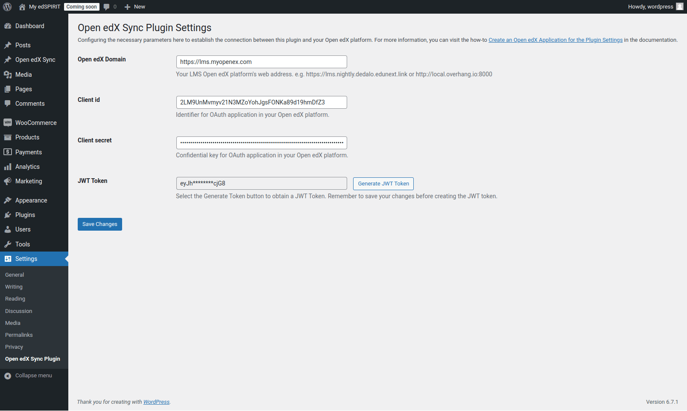

WordPress Plugin for `Tutor`_
#############################

.. image:: https://img.shields.io/pypi/v/tutor-contrib-wordpress?logo=python&logoColor=white
   :alt: PyPI releases
   :target: https://pypi.org/project/tutor-contrib-wordpress

.. image:: https://static.pepy.tech/badge/tutor-contrib-wordpress
   :alt: PyPI Downloads
   :target: https://pepy.tech/projects/tutor-contrib-wordpress

.. image:: https://img.shields.io/github/license/codewithemad/tutor-contrib-wordpress.svg?style=flat-square
   :alt: AGPL License
   :target: https://www.gnu.org/licenses/agpl-3.0.en.html

Overview
********

This is a `Tutor`_ plugin that provides complete WordPress integration with your Open edX instance. It includes:

- Full WordPress installation and management
- Integration with the `Open edX Commerce WordPress Plugin`_

If you need help installing the WordPress plugin, check out this `installation guide`_.

Prerequisites
*************

- Tutor 20 (Teak) to 22 and Python 3.10 or newer
- MySQL database (can use the same one as Open edX)

.. note::
   Plugin v2 supports ``tutor>=20,<23``. For Tutor 15 to 19 (Olive to Sumac) and Python 3.9, pin the old release:
   ``pip install "tutor-contrib-wordpress<2"``.

Installation
************

First, install the plugin by running:

.. code-block:: bash

    pip install -U tutor-contrib-wordpress
    # or with tutor
    tutor plugins install wordpress

Enable the plugin and run the launch command:

.. code-block:: bash

    tutor plugins enable wordpress
    tutor dev|local|k8s launch

Alternatively, if you already have a running Open edX instance, just run the necessary jobs:

.. code-block:: bash

    tutor dev|local|k8s do init --limit=wordpress
    tutor dev|local|k8s start wordpress

Configuration
*************

The plugin automatically installs WordPress with the Open edX Commerce and Woocommerce plugins. Inside your WordPress
admin panel, go to Settings -> Open edX Sync plugin, and configure:

- **Open edX Domain**
- **Client ID**
- **Client Secret**

To verify the connection, click on "Generate JWT Token". If the process is successful, a new token will be generated.

You can retrieve these configuration values by running:

.. code-block:: bash

    tutor wordpress config

This command will output the current configurations, including the Client ID, Client Secret, Open edX Domain,
and WordPress Domain. Here is an example of the output:

.. code-block:: text

    ===============================================
        WordPress Plugin Configurations
    ===============================================

    Client ID: vvpTamiepPwjZhr0uOQGr5PhYBzp2hQw 
    Client ID (dev): MlbXk1V3wB7nWPAAyLF3McyfBBMqExa4 
    Client Secret: MdrgbtU8Q94He3gejF6Zf5MDookoeozO 

    Open edX Domain: http://local.openedx.io:8000 
    Wordpress Domain: http://site.local.openedx.io:8080

Using an existing WordPress site
********************************

The plugin does two jobs: it runs a WordPress container, and it creates the OAuth2 applications in Open edX that the
WordPress plugin needs. If your WordPress site is hosted elsewhere (another server, a managed host), you only need the second one:

.. code-block:: bash

    tutor config save --set WORDPRESS_RUN_LOCAL=false --set WORDPRESS_HOST=shop.example.com
    tutor dev|local|k8s do init --limit=wordpress
    tutor wordpress config

With ``WORDPRESS_RUN_LOCAL=false`` Tutor does not run, route to or create a database for a WordPress container.
Then, on your external site:

1. Install and activate the `Open edX Commerce WordPress Plugin`_ and WooCommerce (no migration of your site is needed).
2. Go to Settings -> Open edX Sync plugin and enter the values printed by ``tutor wordpress config``.
3. Make sure the site can reach your LMS over HTTPS.

To go the other way and move an existing site into Tutor, keep ``WORDPRESS_RUN_LOCAL=true`` and restore your files into
``$(tutor config printroot)/data/wordpress`` and your database into the ``WORDPRESS_MYSQL_DATABASE`` database.

Variables
*********

The plugin supports the following configuration variables:

- ``WORDPRESS_VERSION``: Plugin version
- ``WORDPRESS_HOST``: WordPress site hostname
- ``WORDPRESS_RUN_LOCAL``: (default: true) Run WordPress inside Tutor. Set to false to only configure Open edX for an external WordPress site.
- ``WORDPRESS_PORT``: (default: 8080) Host port published in dev mode. The container itself always listens on 8080.
- ``WORDPRESS_DEBUG``: (default: true) Dev mode only: enable ``WP_DEBUG`` and debug logging.
- ``WORDPRESS_CONFIG_EXTRA``: (default: empty) PHP code appended to ``wp-config.php``. It is only read when WordPress
  first generates ``wp-config.php``, so edit the file in the data volume for an existing install.
- ``WORDPRESS_PHP_MEMORY_LIMIT``: (default: 256M) PHP ``memory_limit``. Requires an image rebuild.
- ``WORDPRESS_UPLOAD_MAX_FILESIZE``: (default: 64M) PHP ``upload_max_filesize`` and ``post_max_size``. Requires an image rebuild.
- ``WORDPRESS_EXTRA_PLUGINS``: (default: []) List of plugin zip URLs to install in the image. Requires an image rebuild.
- ``WORDPRESS_K8S_RESOURCES``: (default: {}) Kubernetes ``resources`` (requests/limits) for the WordPress container.
- ``WORDPRESS_DOCKER_IMAGE``: Docker image for WordPress
- ``WORDPRESS_OPENEDX_PLUGIN``: URL to the Open edX Commerce plugin
- ``WORDPRESS_WOOCOMMERCE_PLUGIN``: (default: "https://downloads.wordpress.org/plugin/woocommerce.11.3.1.zip")
  The WooCommerce plugin zip file URL. You can specify a different version if needed.
- ``WORDPRESS_OFFICIAL_IMAGE``: (default: "wordpress:7.1.5-php8.4")
  The official WordPress Docker image used as the base for building the plugin's custom image.
  This image includes PHP and Apache server. You can specify a different version or PHP variant if needed.

Database Settings
=================

- ``WORDPRESS_MYSQL_HOST``: MySQL host
- ``WORDPRESS_MYSQL_PORT``: MySQL port
- ``WORDPRESS_MYSQL_DATABASE``: Database name (default: wordpress)
- ``WORDPRESS_MYSQL_USERNAME``: Database username
- ``WORDPRESS_MYSQL_PASSWORD``: Database password (auto-generated)
- ``WORDPRESS_TABLE_PREFIX``: Table prefix (default: ``wp_``)

Storage Settings
================

- ``WORDPRESS_DATA_VOLUME_SIZE``: Size of WordPress persistent volume (default: 5Gi)

OAuth2 Settings
===============

- ``WORDPRESS_OAUTH2_SECRET``: OAuth2 secret key (auto-generated)
- ``WORDPRESS_OAUTH2_KEY_SSO``: OAuth2 client ID (auto-generated)
- ``WORDPRESS_OAUTH2_KEY_SSO_DEV``: OAuth2 development client ID (auto-generated)

Contributing
************

We welcome all contributions! Feel free to open a Pull Request or an Issue.

License
*******

This software is licensed under the terms of the `AGPLv3`_.

.. _Tutor: https://docs.tutor.edly.io
.. _Open edX Commerce WordPress Plugin: https://github.com/openedx/openedx-wordpress-ecommerce
.. _AGPLv3: https://github.com/codewithemad/tutor-contrib-wordpress/blob/main/LICENSE.txt
.. _installation guide: https://docs.openedx.org/projects/wordpress-ecommerce-plugin/en/latest/plugin_quickstart.html
